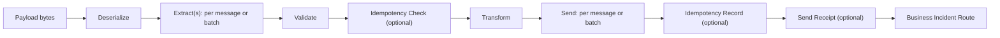

# Bulk Loader

> A Loader for messages that arrive in batches, where any extractor and the sender can make one call for the whole batch instead of one per message.

## How it works



The Bulk Loader runs the same steps as the [Loader](loader.md), in the same order, for every message of a batch. Each message keeps its own context, its own result and its own business incident, as if it were loaded on its own.

The difference is that an extractor or the sender can be a **batch step**. It is called once with every message that is still succeeding at that point, rather than once per message. Use one where the external system has a batch endpoint: looking up many references in one request, or writing many records in one request.

- The steps between two batch steps run per message, up to `WithParallelism` messages at a time (default 1).
- A message that fails before a batch step is left out of the call and keeps its own failure.
- A batch step returns one result per message, so one message can fail without failing the rest.

Hosting runs a Bulk Loader on a Dapr bulk subscription with `AddBulkLoader`. You can also call `Execute` directly with a batch of payloads and contexts.

!!! note "Step namespace"
    The per-message steps are the Loader's, from `Intropy.Framework.Blocks.Loader.Steps`. The batch
    steps, `BatchExtractStep` and `BatchSendStep`, are in `Intropy.Framework.Blocks.BulkLoader.Steps`.

## Building a Bulk Loader

A batch lookup, then validation and transform per message, then one call to the destination:

```csharp
var pipeline = BulkLoaderBuilder<ProductChanged, ProductRow, Context>.Create("products", serviceProvider)
    .WithDeserializer<ProductChangedDeserializer>()
    .WithBatchExtractor<ProductLookup>()          // one call to the source for the whole batch
    .WithValidator<ProductValidator>()
    .WithIdempotency(
        idExtractor: (change, _) => change.ProductId,
        dateExtractor: (change, _) => change.ChangedAt)
    .WithTransformer<ProductTransformer>()
    .WithBatchSender<ProductBatchSender>()        // one call to the destination for the whole batch
    .WithBusinessIncidents(
        ctx => ctx.Metadata[CloudEventContextKeys.Id],
        ctx => ctx.Metadata[CloudEventContextKeys.Subject])
    .WithParallelism(8)
    .Build();
```

With only per-message steps, it is a Loader running over a batch:

```csharp
    .WithExtractor<ProductLookupOne>()            // one call per message
    .WithSender<ProductSender>()                  // one call per message
```

Per-message and batch extractors can be mixed. They run in the order they are added. The sender is either per message or batch; whichever `With…Sender` call comes last is the one used.

| Position | Per message | Once per batch |
|----------|-------------|----------------|
| Extract | `WithExtractor(ExtractStep)` | `WithBatchExtractor(BatchExtractStep)` |
| Send | `WithSender(SendStep)` | `WithBatchSender(BatchSendStep)` |

Each also has a `<TStep>()` overload that resolves the step's concrete type from DI. `WithSenderFromServices()` resolves a registered `SendStep<TOutput, TCtx>`, and `WithBatchSenderFromServices()` resolves a registered `BatchSendStep<TOutput, TCtx>`.

## Implementing a batch step

A batch step gets the messages still succeeding, each with its value and its context. It must return exactly one `StepResult` per entry, **in the same order**. The order is how each result finds its message again, and a wrong count fails the whole batch.

```csharp
public sealed class ProductLookup(IProductSource source) : BatchExtractStep<ProductChanged, Context>
{
    public override async Task<IReadOnlyList<StepResult<ProductChanged>>> ExecuteBatchAsync(
        IReadOnlyList<(ProductChanged Value, Context Context)> entries, CancellationToken ct)
    {
        // Several messages may name the same product: ask for each once.
        var products = await source.GetAsync(entries.Select(e => e.Value.ProductId).Distinct(), ct);

        return [.. entries.Select(e => products.TryGetValue(e.Value.ProductId, out var product)
            ? (StepResult<ProductChanged>)new StepResult<ProductChanged>.Success(e.Value with { Product = product })
            : new StepResult<ProductChanged>.BusinessFailure(
                new BusinessIncidentData { Description = $"Unknown product {e.Value.ProductId}" }, Retriable: false))];
    }
}
```

- **The input has room for what is extracted.** A batch extractor returns the same type it is given, like `ExtractStep`. When messages carry only a reference, have the deserializer produce a model with the reference and an empty slot for the data, and let the extractor fill it in.
- **Duplicates are the step's to collapse.** The step gets every message, including several that name the same thing. Ask the external system once per distinct key, and give each message its own result.
- **One message's problem is that message's result.** A reference the source doesn't know, or a record the destination rejects, is that entry's own `BusinessFailure`. The other messages go on.
- **An exception fails every message in the call.** An exception the step doesn't catch becomes the same business failure for every entry. It is retriable by default, so the messages are redelivered; override `ExceptionsAreRetriable` to make it terminal, and `MapException` to shape the incident.

## Idempotency

The idempotency check runs after the extractors and validation, so with a batch lookup it hashes the data that was looked up, not the reference the message carried. The record runs per message after the send, from the message's own context.

`WithIdempotency` takes explicit id and date extractors. In a routing bulk loader, each route's records are kept apart by default (`IdempotencyScope.Route`).

## Tracing

Each message is traced in its own trace, under one pipeline span from its first step to its last, on both sides of every batch step. Each batch step call is traced once in a trace of its own, linked both ways to the messages it carried. See [Bulk loader traces](../concepts/observability.md#bulk-loader-traces).

## Related

- [Loader](loader.md): the single-message pipeline, and the per-message steps
- [Observability](../concepts/observability.md): the trace shape of a batch
